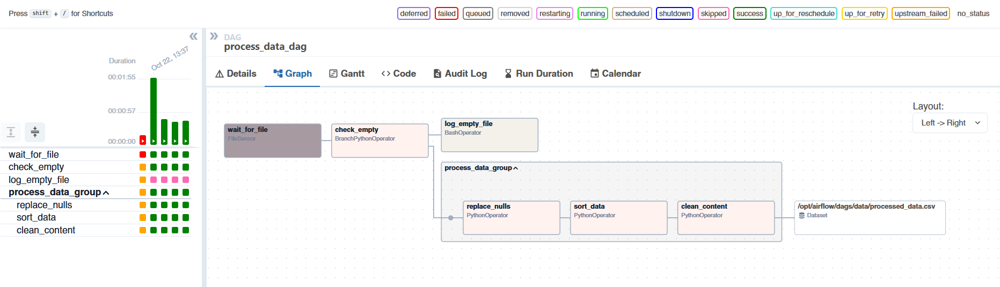
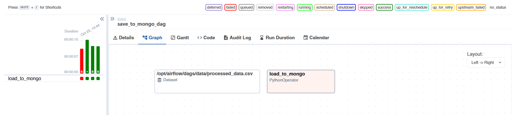
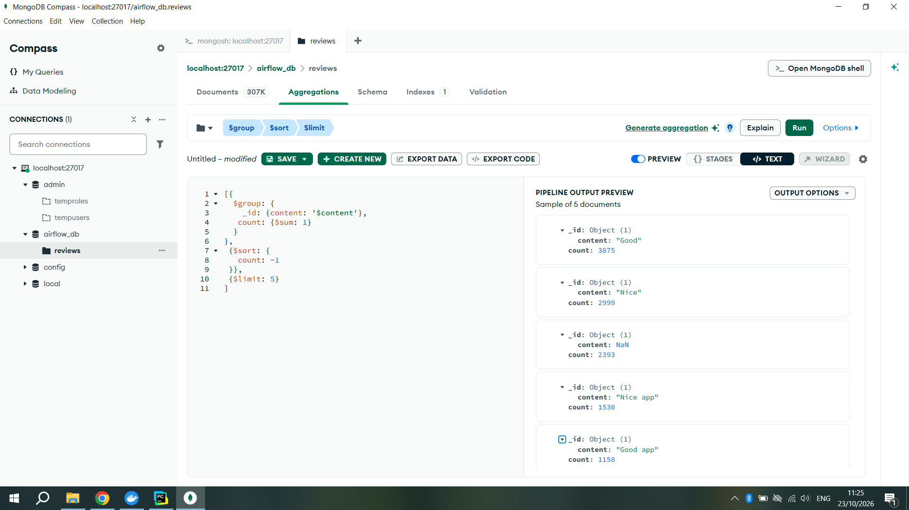
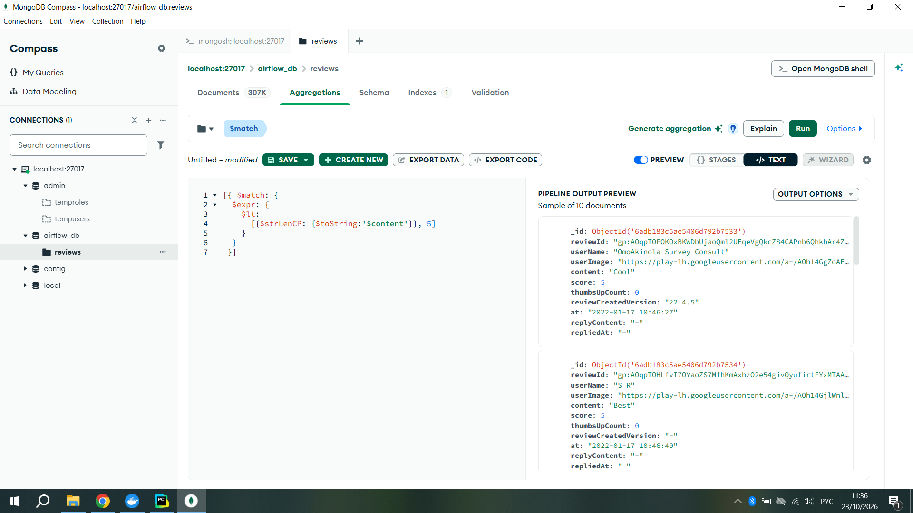
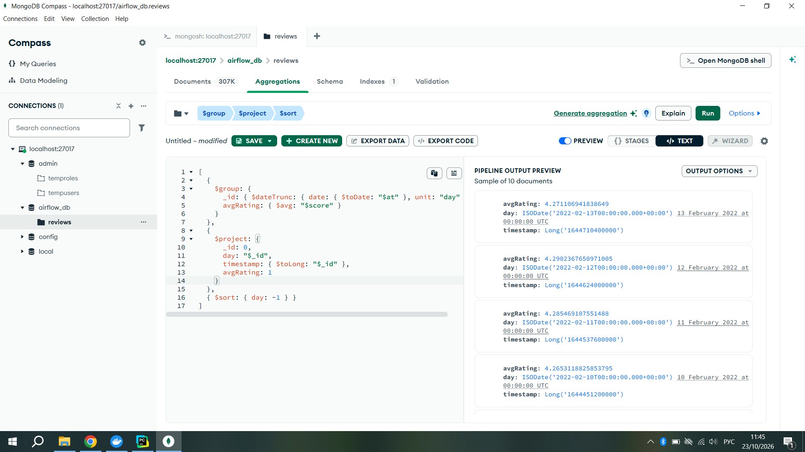

# Airflow_task 
## Project Overview
This project demonstrates an automated ETL (Extract, Transform, Load) data pipeline using **Apache Airflow**. 
The pipeline consists of two interconnected DAGs:
1. **Data Processing DAG:** Monitors a directory for a new CSV file, checks if it's empty, and if not, processes the data (replaces nulls, sorts by date, and cleans text from emojis).
2. **MongoDB Loading DAG:** Triggered automatically via **Data-aware scheduling (Dataset)** after the first DAG finishes. It loads the cleaned data into a MongoDB collection.

## Tech Stack
* **Apache Airflow 2.9.0** (Dockerized)
* **Python 3.12** (Pandas, Regex)
* **MongoDB** (Dockerized)
* **MongoDB Compass** (for data visualization and aggregation queries)
* **Docker Compose** (for local infrastructure)

## How to Run

1. **Clone the repository:**
   ```bash
   git clone <your-repo-url>
   cd Airflow_task
## Pipeline Architecture (DAG Graphs)
1. **Data Processing DAG (processing_data_dag)**:
This DAG includes a FileSensor, a Branching operator (to check for empty files), and a TaskGroup for data transformations.

2. **MongoDB Loading DAG (save_to_mongo_dag)**:
This DAG is triggered by a Dataset update and loads the processed CSV into MongoDB.


## MongoDB Aggregation 

After the data is loaded into MongoDB (collection reviews), the following analytical queries were executed using MongoDB Compass.
1. **Top 5 Most Frequent Comments**:

2. **Entries where "content" is less than 5 characters long**:

3. **Average Rating per Day (as Timestamp)**:


 
